# FridgeManager_Web
냉장고를 부탁해 — 냉장고 재료·유통기한·내 일정과 취향을 보고, **버릴 뻔한 재료부터 쓰는 레시피**를 추천하는 냉장고 에이전트.
기획은 [PLAN.md](PLAN.md), 팀 작업 방식은 PLAN.md 11장을 보세요.

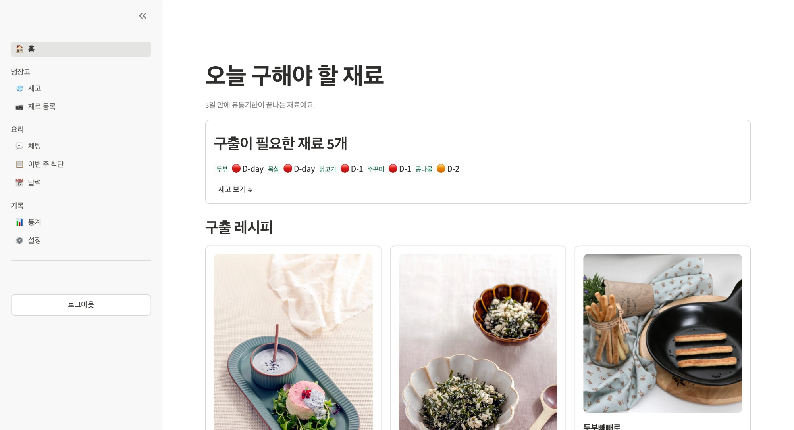

## 지금 상태 (2026-11-26)
기획안의 **Phase 1~6 모두 완료, AWS EC2에 배포되어 동작 중**이에요. Phase 7(Google Calendar 연동·이메일/푸시 알림)은 하지 않기로 했어요.

| Phase | 내용 | 담당 | 상태 |
|---|---|---|---|
| 0 | 프로젝트 세팅, 로그인, DB | A | ✅ |
| 1 | 재고 + 유통기한 | A | ✅ |
| 2 | 영수증·냉장고 사진으로 재료 등록 | A | ✅ |
| 3 | 레시피 검색 (식품안전나라 1,151개, 임베딩) + 홈 추천 카드 | B | ✅ |
| 4 | 에이전트 채팅, 재고 빼기, 취향·알레르기 기억 | A | ✅ |
| 5 | 달력·일정, 주간 식단, 장보기 목록 | A | ✅ |
| 6 | 대시보드, 요리 평가, 피드백 학습 | A | ✅ |
| 7 | Google Calendar 연동, 알림 | – | ❌ 하지 않음 |

## 주요 기능
| 화면 | 할 수 있는 것 |
|---|---|
| **로그인** | 이메일·비밀번호 회원가입/로그인 (bcrypt) |
| **홈** | 3일 안에 끝나는 재료, 그 재료로 만들 구출 레시피 카드 3개 |
| **재고** | 재료 추가(카탈로그 147개로 유통기한 추정), D-day 색 표시, 표에서 바로 수정, 다 먹음·버림·삭제 |
| **재료 등록** | 영수증·냉장고 사진 → Claude 가 재료·수량·구입일 추출 → 고칠 수 있는 확인 표 → 저장. 처음 보는 재료는 보관 일수를 추정해 카탈로그에 추가 |
| **채팅** | 에이전트가 임박 재료 우선으로 레시피 추천(검색 결과만, 지어내지 않음), 알레르기·취향 기억, "이거 만들게" → 재고 빼기 미리보기 → **확정해야** 반영 → 평가 |
| **달력** | 바쁜 날·운동·손님 일정, 유통기한, 짜 둔 식단을 한 달 달력에 |
| **이번 주 식단** | 일정 반영 7일 저녁 메뉴 (바쁜 날 15분 이하, 운동 날 고단백, 손님 수+1 인분), 임박 재료가 앞 날짜로. 장보기 목록(식단 재료 − 재고), 산 것 → 재고 |
| **통계** | 구출한 재료·버린 재료·구출률, 주별 구출 vs 폐기 차트, 자주 먹은 요리 TOP 5, 평가 대기 요리 |
| **설정** | 기억한 취향·알레르기 보기/추가/삭제 |

**피드백 학습**은 모델 재학습이 아니라 내 기록으로 추천 순서를 조정해요: 👍 +, 👎 −, 최근 7일 먹은 요리 −, 싫어하는 맛·재료 −, 좋아하는 것·식단 목표 +. 후기("너무 짰어")는 Haiku 가 취향("싫어함: 짠맛")으로 바꿔 기억해요.

## 화면 미리보기

### 홈: 버릴 뻔한 재료와 구출 레시피
| 오늘 구해야 할 재료 | 구출 레시피 카드 |
|---|---|
|  | 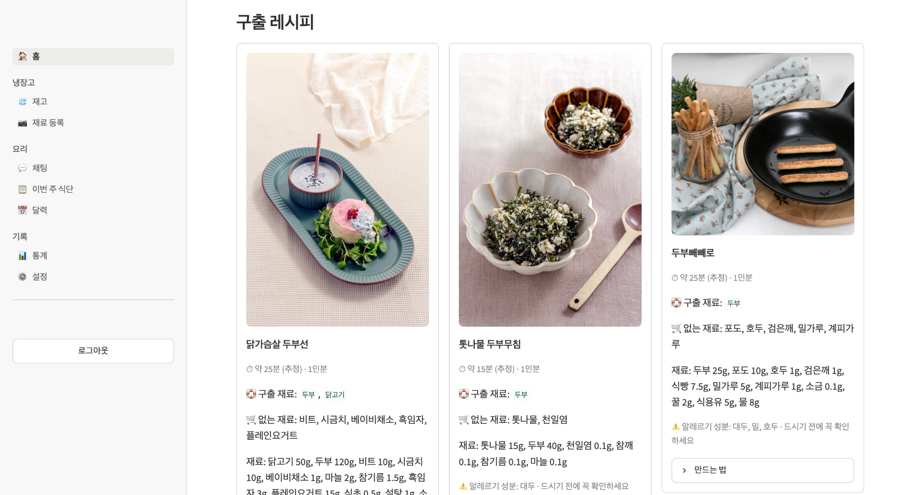 |
| 3일 안에 유통기한이 끝나는 재료를 D-day 색으로 보여줘요. | 임박 재료를 쓰는 레시피. 없는 재료와 알레르기 성분도 함께 보여줘요. |

### 냉장고: 재고 관리와 사진으로 재료 등록
| 재고 | 재료 등록 |
|---|---|
| 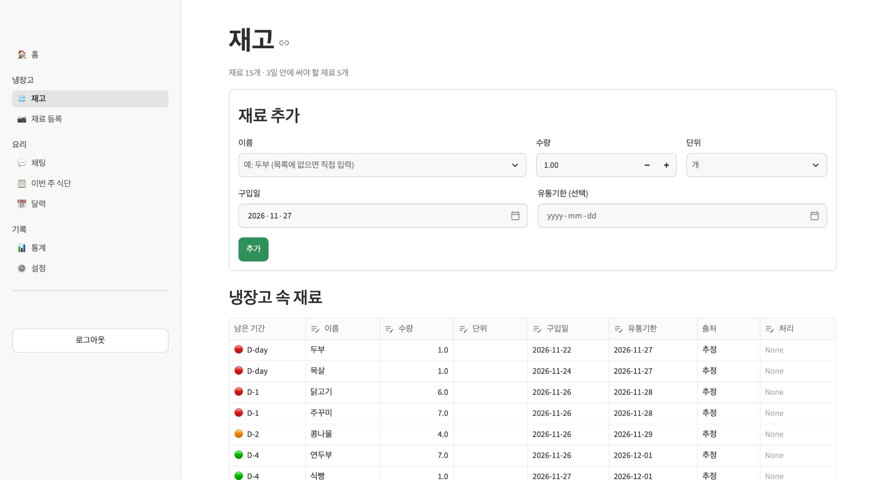 | 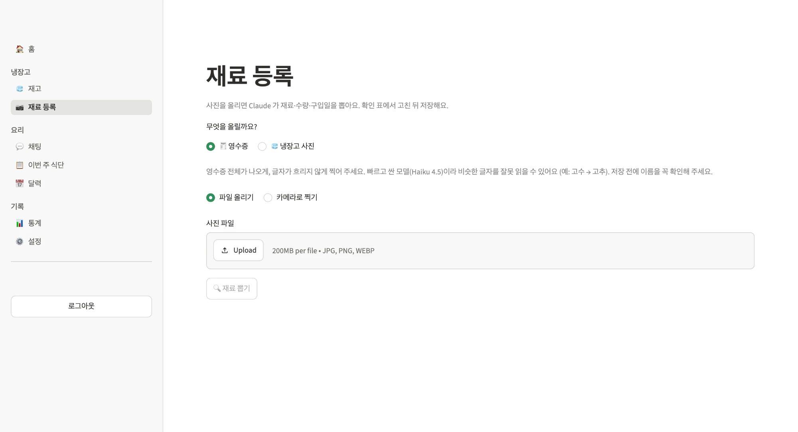 |
| 카탈로그로 유통기한을 추정하고, 남은 기간 순으로 정렬해요. | 영수증이나 냉장고 사진을 올리면 Claude 가 재료·수량·구입일을 뽑아요. |

### 채팅: 냉장고 에이전트
| 임박 재료로 추천 | "이거 만들게" → 재고 빼기 확인 |
|---|---|
| 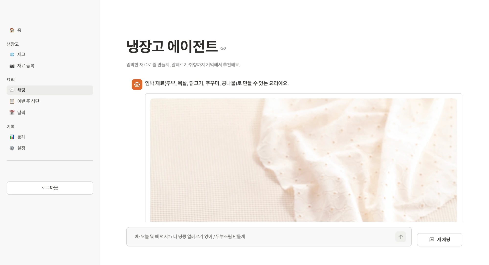 | 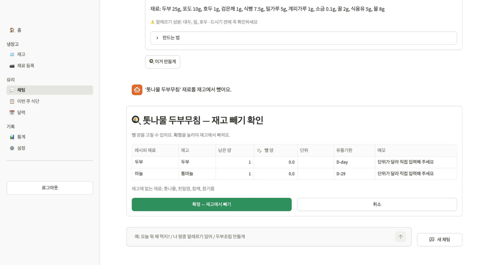 |
| 검색된 레시피만 추천해요(지어내지 않아요). | 뺄 양을 고칠 수 있고, **확정**을 눌러야 재고에 반영돼요. |

### 계획: 이번 주 식단과 달력
| 이번 주 식단 | 달력 |
|---|---|
| 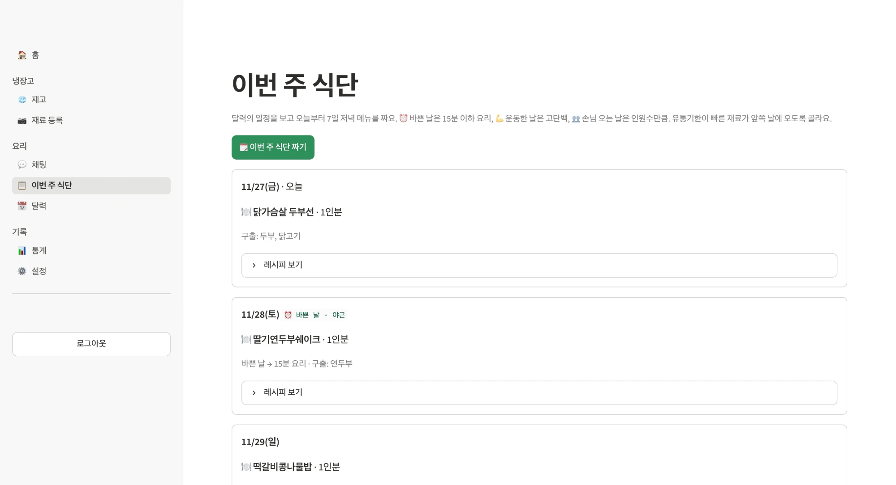 | 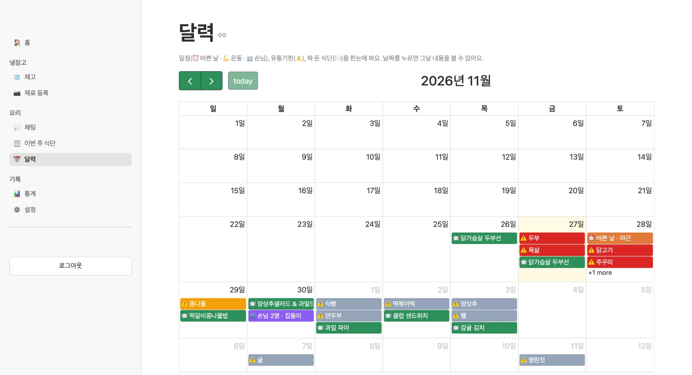 |
| 바쁜 날은 15분 요리, 운동한 날은 고단백, 손님 오는 날은 인원수만큼 짜요. | 일정·유통기한·식단을 한 달 달력에 모아 보여줘요. |

<p align="center">
  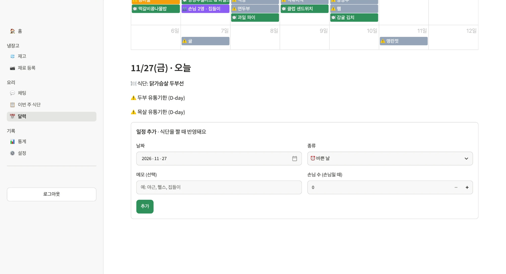<br>
  <sub>날짜를 누르면 그날의 식단과 유통기한을 보여줘요. 여기서 추가한 일정은 식단을 짤 때 반영돼요.</sub>
</p>

### 기록: 통계와 기억한 취향
| 통계 | 설정 |
|---|---|
| 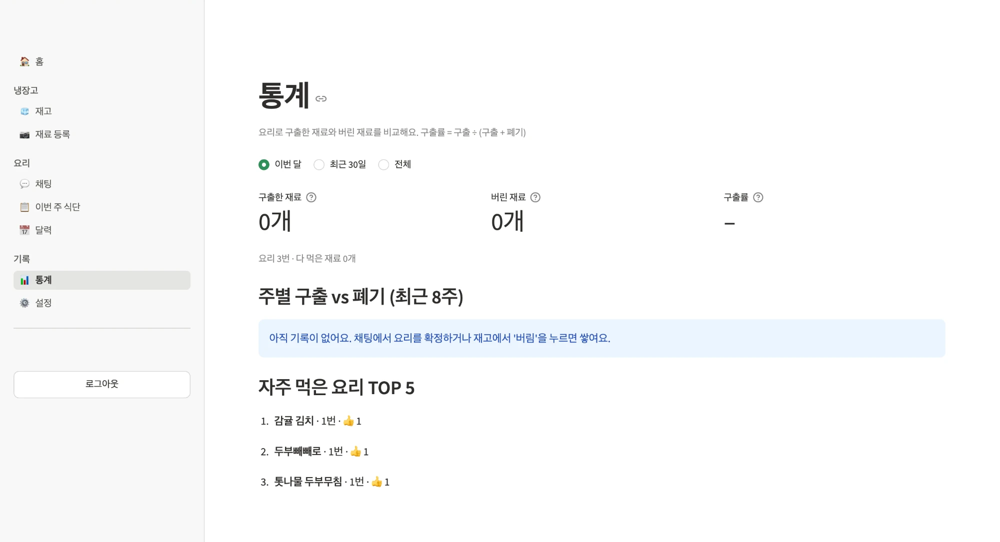 | 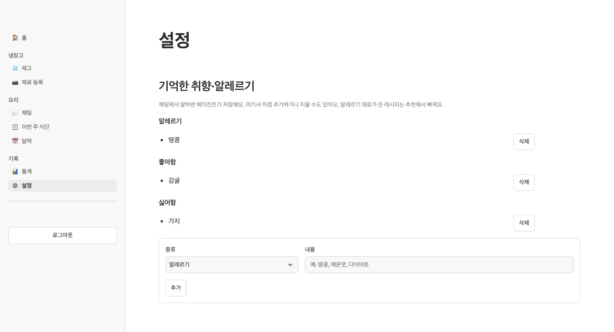 |
| 구출한 재료·버린 재료·구출률, 자주 먹은 요리 TOP 5 | 채팅에서 기억한 알레르기·좋아함·싫어함을 보고 고쳐요. |

## AI 사용 (AWS Bedrock)
| 일 | 모델 | 비고 |
|---|---|---|
| 채팅 에이전트(도구 8개), 영수증 읽기, 후기 → 취향, 보관 일수 추정 | Claude **Haiku 4.5** | 기본 모델 (`CLAUDE_MODEL`) |
| 냉장고 사진 읽기 | Claude **Sonnet 4.6** | 비용이 커서 여기서만 (`CLAUDE_MODEL_SMART`) |
| 레시피 의미 검색 | Amazon **Titan Text Embeddings V2** | 서울 리전 (`BEDROCK_REGION`) |
| 주간 식단 | **안 씀** | 코드 규칙으로 (비용 0) |

- EC2 는 서버 역할(IAM)로, 로컬은 `aws login` 으로 인증해요. 이 AWS 계정에는 Claude 5.x 계열이 열려 있지 않아 열린 모델만 써요 (열리면 `.env` 모델 이름만 바꾸면 돼요).
- `anthropic[bedrock]` 은 2 미만으로 고정 (2.x 가 보내는 API 버전을 Bedrock 의 4.6 이하 모델이 거부할 수 있어서).

## 설계 원칙·안전장치
- **계산은 코드로, AI 는 추출·판단만**: 유통기한·재고 차감·통계·식단은 Python 순수 함수(테스트됨).
- **AI 결과는 확인 후 저장**: 사진 인식은 확인 표, 재고 빼기는 미리보기 → 확정. 확정을 누르면 확인 화면이 먼저 닫혀 두 번 빠지지 않아요.
- **알레르기 이중 차단**: B 의 검색에서 한 번, A 의 연결점(`lib/recipe_source.py`)에서 한 번 더. '계란'↔'알류', '새우'↔'갑각류'처럼 같은 그룹도.
- **사진 인식 안전장치**: 줄마다 원문·`is_food` 를 받아 생활용품 거르기, 짧은 이름 바꿔치기 방지, 먹는 게 아니면 공용 카탈로그에 넣지 않음.
- **사용자 데이터 분리**: RLS 대신 모든 SQL 에 `where user_id = %s`. DB 는 기존 RDS 의 `fridge` 스키마 + 앱 전용 계정(다른 앱 데이터에 접근 불가).
- **비밀값**: `.env` 는 git 에 올리지 않아요 (`.gitignore`). 견본은 `.env.example`.

## 알려진 한계
- **HTTP 만 지원** — 실제 사용자를 받으려면 HTTPS 가 필요해요.
- **새로고침하면 로그아웃** (Streamlit 세션이 탭 단위).
- **영수증 인식(Haiku)** 은 비슷한 글자를 잘못 읽을 수 있어요 (시험에서 '고수' → '고추'). 확인 표에서 고쳐 주세요.
- 레시피가 단위를 g 로 적고 재고가 '개'면 재고 빼기 양을 추정해요 (개수 단위는 1개, 그 밖은 0 → 확인 표에서 고치기).

## 바뀐 결정 기록
| 처음 | 지금 | 이유 |
|---|---|---|
| Next.js + TypeScript | **Python + Streamlit** | 팀이 아는 언어로 코드를 읽고 고칠 수 있게 |
| Supabase | **기존 AWS RDS PostgreSQL** | 이미 있는 DB 재사용, pgvector 지원 |
| Anthropic API 키 | **AWS Bedrock** | EC2 서버 역할로 인증 |
| Phase 2·4·5·6 일부 B 담당 | **A 가 맡음** | Phase 3 가 길어져서 |
| Phase 7 | **하지 않음** | |

## 작업 흐름
브랜치(`phaseN-…`/`fix-…`) → 구현 + 테스트 → 실제 Bedrock·RDS 로 확인 → 커밋·push → PR → `main` 합치기 → EC2 배포(아래) → 서버에서 다시 확인 → 브랜치 정리. **배포는 `main` 에서만.**

## 스택
Python 3.9+ · Streamlit · AWS RDS PostgreSQL 18 + pgvector (`fridge` 스키마) · psycopg 3 · bcrypt · Claude on AWS Bedrock · Titan V2 임베딩 · streamlit-calendar · Altair · pytest
배포: AWS EC2 (Python 3.12, systemd `deploy/fridge-app.service`, 포트 8501)

## 처음 실행하기
1. 가상환경을 만들고 패키지를 설치해요.
   ```bash
   python3 -m venv .venv
   source .venv/bin/activate
   pip install -r requirements-dev.txt
   ```
   > Anaconda(Intel 모드) Python에서 `cryptography`/`bcrypt` 설치가 실패하면:
   > `pip install --only-binary=:all: -r requirements-dev.txt`
2. 환경변수 파일을 만들고 값을 채워요. DB 비밀번호(`fridge_app` 계정)는 팀 리더에게 안전한 경로로 받아요.
   ```bash
   cp .env.example .env
   ```
3. RDS는 EC2에서만 접속되므로, **다른 터미널에서 SSH 터널을 열어 둬요** (`localhost:5433` → RDS).
   ```bash
   ./scripts/tunnel.sh
   ```
4. 테이블을 만들어요 (이미 만들어져 있으면 "모두 최신이에요"만 나와요).
   ```bash
   python scripts/migrate.py
   ```
5. (채팅 에이전트를 쓰려면) AWS 자격증명이 필요해요. EC2에서는 서버 역할로 자동이고, 로컬에서는 `aws login`으로 로그인해요. 없으면 채팅 입력이 꺼지고 "임박 재료로 바로 추천" 버튼만 동작해요.
6. 실행 → http://localhost:8501
   ```bash
   streamlit run app.py
   ```

## 레시피 넣기 (Phase 3)
식품안전나라 레시피 약 1,150개를 임베딩(Amazon Titan Text Embeddings V2, Bedrock)과 함께 `recipes` 표에 넣어요.
먼저 `python scripts/migrate.py`로 `db/0003_recipes.sql`을 실행해 두세요.

- **나눠서 할 때** (임베딩 만드는 사람과 DB에 넣는 사람이 다를 때)
  ```bash
  # 1) 임베딩 만드는 사람: API → 변환 → 임베딩 → 파일 (DB 필요 없음)
  #    .env: RECIPE_API_KEY, BEDROCK_REGION(Titan V2가 있는 리전), AWS_PROFILE
  python scripts/seed_recipes.py --dry-run --out db/seed/recipes_seed.jsonl.gz
  # 2) DB에 넣는 사람: 파일 → DB (API 키·Bedrock 필요 없음, 로컬은 터널 먼저)
  python scripts/seed_recipes.py --load-file db/seed/recipes_seed.jsonl.gz
  ```
- **한 번에 할 때**: `python scripts/seed_recipes.py`
- 여러 번 실행해도 레시피 수는 늘지 않아요 (`source_id`로 덮어씀).
- 검색할 때도 같은 모델로 검색어를 임베딩해요. 앱이 도는 곳(로컬은 AWS 로그인, EC2는 서버 역할의 `bedrock:InvokeModel` 권한)과 `.env`의 `BEDROCK_REGION`이 필요해요. Bedrock을 못 부르면 재료 이름 글자 검색으로 대신해요.

## 테스트
```bash
pytest
```
DB·Bedrock 없이 돌아가요 (터널 불필요, 현재 134개). AI 와 DB 는 가짜로 바꿔 끼워 검사하고, 화면은 Streamlit `AppTest` 로 실행해요.
| 영역 | 테스트 파일 |
|---|---|
| 날짜·유통기한·재고 | `test_dates.py`, `test_inventory_rules.py`, `test_inventory_page.py` |
| 로그인 | `test_passwords.py` |
| 재료 등록 (Phase 2) | `test_ingest_rules.py`, `test_ingest.py`, `test_upload_page.py` |
| 레시피 (Phase 3, B) | `test_recipe_import.py`, `test_recipe_rules.py`, `test_recipes_search.py`, `test_home_page.py`, `test_seed_recipes.py` |
| 에이전트·재고 빼기·알레르기 (Phase 4) | `test_agent.py`, `test_cooking_rules.py`, `test_cooking.py`, `test_recipe_source.py`, `test_chat_page.py` |
| 일정·식단·장보기 (Phase 5) | `test_schedule.py`, `test_meal_plan_rules.py`, `test_shopping_rules.py`, `test_plan_pages.py` |
| 통계·피드백 (Phase 6) | `test_stats_rules.py`, `test_personalize.py`, `test_feedback.py`, `test_dashboard_page.py` |

## DB 구조 바꾸기
1. `db/`에 다음 번호 파일을 만들어요 (지금 `0005`까지 사용 → 다음은 `db/0006_….sql`). **이미 실행된 파일은 고치지 않아요.**
2. `python scripts/migrate.py`로 실행해요. `--status`로 실행 여부를 볼 수 있어요.
3. 사용자 데이터 테이블은 RLS가 없으니, 코드에서 항상 `where user_id = %s`로 걸러요.

## 폴더 구조
```
app.py                 시작 파일: 로그인 확인 + 메뉴(st.navigation)
views/                 화면 (페이지 하나 = 파일 하나)
  home.py inventory.py upload.py chat.py plan.py calendar.py dashboard.py settings.py login.py
lib/                   로직
  config.py            .env 읽기
  db.py                PostgreSQL 연결 풀, fetch_all / fetch_one / execute
  auth.py              로그인·회원가입·로그아웃, require_user()
  passwords.py         bcrypt 해시 — 순수 함수
  models.py            팀 공용 데이터 모양 (AppUser, InventoryItem, Recipe, RecipeMatch …)
  dates.py             날짜 계산 (한국 시간 기준) — 순수 함수
  catalog.py           재료 카탈로그 매칭 — 순수 함수
  inventory_rules.py   입력 검사·유통기한 결정 — 순수 함수
  inventory.py         재고 DB 읽기·쓰기, get_expiring()
  preferences.py       취향·알레르기 기억
  cooking_rules.py     "이거 만들게" 재고 빼기 계획 (FEFO, 단위 환산) — 순수 함수
  cooking.py           재고 빼기 적용 + 요리 기록
  llm.py               Claude 클라이언트 (AWS Bedrock)
  agent.py             냉장고 에이전트 (도구 8개, 스트리밍)
  recipe_source.py     레시피 검색 연결점 (B의 search_recipes + 알레르기 이중 안전장치)
  schedule.py          일정 (바쁜 날·운동·손님)
  meal_plan_rules.py   주간 식단 짜기 규칙 (Claude 없이) — 순수 함수
  meal_plan.py         주간 식단 저장·조회
  shopping_rules.py    장보기 목록 계산 (식단 재료 − 재고) — 순수 함수
  shopping.py          장보기 목록 저장, 산 것 → 재고
  stats_rules.py       대시보드 숫자 (주별 구출·폐기, 구출률, TOP 5) — 순수 함수
  stats.py             대시보드용 DB 조회
  personalize.py       피드백 학습: 평가·최근 기록·취향으로 추천 순서 조정 — 순수 함수
  feedback.py          요리 평가 저장, 후기 → 취향 (Haiku 4.5)
  feedback_ui.py       요리 후 평가 칸 (채팅·대시보드 공용)
  ingest_rules.py      재료 등록: Claude 응답 검사·생활용품 거르기·사진 줄이기 — 순수 함수
  ingest.py            재료 등록: 영수증(Haiku)·냉장고 사진(Sonnet) 인식, 처음 보는 재료 보관 일수 추정
  ui.py                공용 화면 조각
db/                    SQL 마이그레이션 (번호 순서)
scripts/
  migrate.py           db/*.sql 실행
  tunnel.sh            로컬 개발용 SSH 터널
tests/                 pytest
deploy/                EC2 systemd 서비스 파일
```

## EC2 배포 (main 브랜치만)
서버의 `.env`는 로컬과 다르게 `PG_HOST=<RDS 주소>`, `PG_PORT=5432`(터널 없이 바로 접속), `BEDROCK_REGION=ap-northeast-2` 예요.
서버 `.env` 는 서버에서 직접 고치지 말고, 받아서 고친 뒤 다시 올려요.
```bash
rsync -az --delete --exclude .venv --exclude .git --exclude .env --exclude data ./ ec2-user@<서버>:/home/ec2-user/fridge-manager/
ssh ec2-user@<서버> 'cd ~/fridge-manager && .venv/bin/pip install -r requirements.txt && .venv/bin/python scripts/migrate.py && sudo systemctl restart fridge-app'
```
- 처음 한 번은 `python3.12 -m venv .venv` 로 가상환경을 만들고, `deploy/fridge-app.service` 를 `/etc/systemd/system/` 에 설치해요.
- 레시피가 비어 있으면 `.venv/bin/python scripts/seed_recipes.py --load-file db/seed/recipes_seed.jsonl.gz`.
- 배포 뒤 확인: `curl localhost:8501/_stcore/health` 가 200, `journalctl -u fridge-app` 에 오류 없음.
